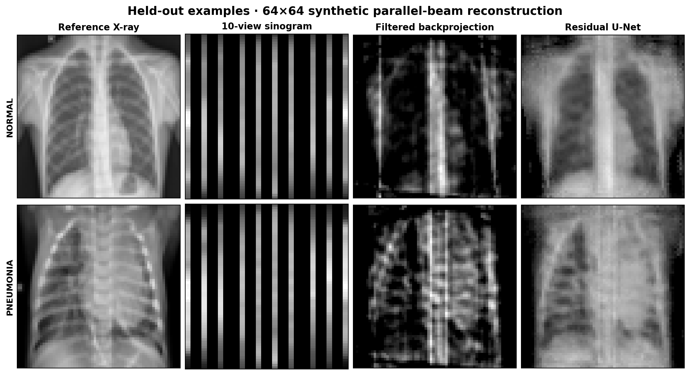

# Physics-Informed Neural Networks for CT Reconstruction from Sparse Views

**Student:** Kolakanuru Thippeswamy  
**Roll No / ID:** 48 / `20241CAI0055`  
**Dataset:** Chest X-Ray Images (Pneumonia), [Kaggle](https://www.kaggle.com/datasets/paultimothymooney/chest-xray-pneumonia)

> This is a 2D synthetic reconstruction study using radiographs as reference images. It does not reconstruct clinical CT scans or establish clinical performance.

## Abstract

Sparse-view computed tomography reconstruction is an ill-posed inverse problem: reducing projection angles creates missing information and streak artifacts. This project forms a controlled 2D experiment from chest radiographs by simulating parallel-beam Radon projections, retaining sparse angle subsets, and comparing ramp-filtered backprojection with a residual U-Net. The network is trained with image-reference, measured-projection consistency, and total-variation losses. A matched CPU comparison trained a seeded random subset of 512 training images at 64×64 resolution for 20 epochs and retained checkpoints at 5, 10, 15, and 20 epochs; the lowest validation L1 selected the 17-epoch checkpoint. Evaluation on all 624 provided test images gave the 10-view learned model a mean PSNR of 22.51 dB and mean SSIM of 0.780, compared with 10.40 dB and 0.342 for filtered backprojection. These results demonstrate the pipeline on synthetic projections only. The X-rays are not calibrated CT slices and have no paired CT measurements, so the results do not establish clinical CT reconstruction performance.

## 1. Problem formulation

Let `x ∈ [0,1]^(H×W)` be a resized chest X-ray used as a reference image. A parallel-beam Radon operator `A_Θ` generates projections at angles `Θ`; a sparse subset `Ω` is retained to form measurements `y = M_Ω A_Θ x`. The reconstruction `x̂` is estimated from these measurements. In this implementation, training minimizes a weighted objective comprising normalized L1 consistency on measured sinogram bins, L1 image-reference loss, and anisotropic total variation:

`L = 0.25 L_data + L_image + 0.01 TV(x̂)`.

The forward model is synthetic and operates on 2D radiographs. These images are not known attenuation maps, and the dataset contains no paired CT volumes or scanner projections.

## 2. Literature review

Recent sparse-view CT research combines learned priors with projection physics in several ways. Zhou et al. (2021) proposed a cascaded residual dense spatial-channel attention network with a projection-data fidelity layer for limited-view tomography. Its explicit sinogram consistency motivates including measured-view consistency in this project, although this project uses a much smaller image-domain residual model. [Paper](https://doi.org/10.1109/TMI.2021.3066318)

Su et al. (2022) generalized deep iterative reconstruction by learning components of an unrolled sparse-view CT optimization procedure, including data fidelity and regularization. Their model-driven design is closely related to the objective of this project, but the present implementation is not an unrolled network: it learns a post-FBP correction with a projection loss. [Paper](https://doi.org/10.1088/1361-6560/ac3eae)

Kandarpa et al. (2022) introduced LRR-CED, using low-resolution reconstruction information for direct sparse-view CT reconstruction. This highlights the value of reconstruction-aware inputs and supports using a backprojected image as the U-Net input. [Paper](https://doi.org/10.1088/1361-6560/ac7bce)

Li et al. (2023) proposed a cascade-based dual-domain correction network that processes image and projection information and applies sinogram data correction. The use of both domains is relevant to this project's Radon consistency term, while their cascade is more elaborate than the single residual U-Net used here. [Paper](https://doi.org/10.1016/j.compbiomed.2023.107345)

Xu, Li, and Lin (2023) presented a deep-fusion network for sparse-view reconstruction on clinical diagnostic scanners. Their work emphasizes reconstruction quality and speed under scanner settings; the present synthetic parallel-beam setup does not reproduce those scanner geometries. [Paper](https://doi.org/10.1109/EMBC40787.2023.10341175)

Lahiri et al. (2023) studied data-consistent supervised and adversarial learning for sparse-view cone-beam CT when training data are scarce. Their emphasis on scarce data and consistency is pertinent to this project’s limited training subset, but their 3D cone-beam experiments use real CT geometry unlike this 2D demonstration. [Paper](https://doi.org/10.1109/TCI.2023.3272339)

Ayad, Larue, and Nguyen (2024) introduced QN-Mixer, which combines quasi-Newton ideas with an MLP-Mixer model for sparse-view CT reconstruction. It represents a recent optimization-inspired alternative to convolutional reconstruction networks. [Paper](https://openaccess.thecvf.com/content/CVPR2024/html/Ayad_QN-Mixer_A_Quasi-Newton_MLP-Mixer_Model_for_Sparse-View_CT_Reconstruction_CVPR_2024_paper.html)

## 3. Methodology

### Dataset and splits

The supplied Kaggle archive was extracted to `data/chest_xray/`. Images were converted to grayscale and resized to 64×64, with values scaled to `[0,1]`. The provided `train`, `val`, and `test` splits were preserved. Training used a deterministic random subset of 512 images from the training split (`seed=48`); validation used all 16 supplied validation images; final evaluation used all 624 test images (234 NORMAL and 390 PNEUMONIA). Labels were not used by the reconstruction model.

### Forward model and reconstruction

The native PyTorch projector rotates images with bilinear interpolation and sums detector rows at 30 uniformly spaced angles over `[0, π)`. Training retained 10 approximately uniform angles. The FBP baseline applies a ramp filter in detector-frequency space and backprojects the filtered measurements. A residual U-Net refines the normalized FBP image. The training loss combines normalized L1 error on measured projection bins, L1 error against the reference image, and anisotropic total variation, with weights 0.25, 1.0, and 0.01 respectively.

### Training details

Training used PyTorch 2.8.0, torchvision 0.23.0, Adam with learning rate 0.001, batch size 8, a 20-epoch schedule, and CPU execution. Seed 48 was used. The checkpoint with the lowest validation L1 was selected; it came from epoch 17 (`val_l1=0.05160`). Checkpoint: `outputs/best.pt`.

## 4. Quantitative results

Metrics are arithmetic means over all 624 test images, with image intensities clipped to `[0,1]`. The selected epoch-17 model was trained with 10 views; the 4- and 5-view rows test generalization to fewer views. Values are from `outputs/test_metrics.json`.

| Views | FBP PSNR (dB) | FBP SSIM | Learned PSNR (dB) | Learned SSIM |
|---:|---:|---:|---:|---:|
| 4 | 8.53 | 0.217 | 17.02 | 0.527 |
| 5 | 8.77 | 0.234 | 18.30 | 0.579 |
| 10 | 10.40 | 0.342 | 22.51 | 0.780 |

The learned reconstruction improves both reported metrics over the filtered-backprojection baseline at each tested view count. Metrics rise with more views in this experiment. These averages describe this split and this synthetic operator; they should not be interpreted as clinical CT quality scores. Per-image values are in `outputs/test_per_image.csv`.



## 5. Ablation study

### Epoch-count comparison

Four checkpoints from one matched 20-epoch run were evaluated at 10 sparse views on the same 624 test images. The validation L1 minimum across the full run was at epoch 17. Among the four requested checkpoints, test PSNR and SSIM were highest at epoch 15, then dipped slightly at epoch 20. The selected `outputs/best.pt` uses epoch 17 based on validation loss, rather than selecting a checkpoint by test scores.

| Epochs | Train loss | Validation L1 | Test PSNR (dB) | Test SSIM |
|---:|---:|---:|---:|---:|
| 5 | 0.09368 | 0.06246 | 21.11 | 0.713 |
| 10 | 0.08233 | **0.05537** | 21.92 | 0.751 |
| 15 | 0.07216 | 0.05731 | **22.24** | **0.780** |
| 20 | 0.07197 | 0.05620 | 21.97 | 0.777 |

The result shows that more epochs improved test metrics through epoch 15 in this run, but another five epochs did not help. Training for longer can improve a model while it is still learning; it can also plateau or overfit. Validation metrics, not test metrics, should guide checkpoint selection.

### Sparse-view count

The sparse-angle count was varied at evaluation while holding the trained network and test set constant. This is a view-count ablation, not a loss-term ablation. At 4, 5, and 10 views, the selected learned model scored 17.02, 18.30, and 22.51 dB PSNR respectively, while SSIM was 0.527, 0.579, and 0.780. Filtered backprojection also improved as views increased, from 8.53 dB / 0.217 SSIM at 4 views to 10.40 dB / 0.342 at 10 views. A future loss ablation should retrain matched runs with the data-consistency and TV weights individually set to zero.

## 6. Limitations and future work

The chest X-rays are 2D projection images rather than CT slices with known attenuation values. Applying a Radon transform to them creates a synthetic inverse problem and does not simulate real scanner acquisition. The projector uses simplified parallel-beam geometry and interpolation, and omits photon statistics, scatter, detector response, and fan/cone-beam geometry. Only 512 training images were used due to CPU-only execution; the supplied validation split has only 16 images. The learned network’s results may also reflect dataset source and class imbalance. There is no clinical validation.

Future work should use paired CT images and projections, realistic fan- or cone-beam forward models, noise modeling, larger training and validation sets, multiple random seeds, and matched loss-term ablations. A true learned primal-dual or other explicitly unrolled reconstruction model would be a useful architecture comparison.

## 7. Conclusion

On a synthetic 2D sparse-view reconstruction task, the physics-informed residual U-Net improved mean PSNR and SSIM over ramp-filtered backprojection on the held-out X-ray test split. The result supports the educational value of including projection consistency in an image reconstruction model. It does not demonstrate reconstruction of clinical CT volumes.

## Reproducibility and deliverables

The exact training command was:

```bash
.venv/bin/python -m src.train --data-root data/chest_xray --epochs 20 --image-size 64 --views 30 --sparse-views 10 --batch-size 8 --max-train 512 --max-val 16 --device cpu --output outputs
.venv/bin/python -m src.evaluate --data-root data/chest_xray --checkpoint outputs/best.pt --device cpu
```

The random seed was 48. Checkpoints at epochs 5, 10, 15, and 20 are in `outputs/`; comparison metrics are in `outputs/epoch_comparison/comparison.json`. The selected checkpoint, training history, test summary JSON, and per-image CSV are also in `outputs/`. The dataset and archive are excluded from version control.
